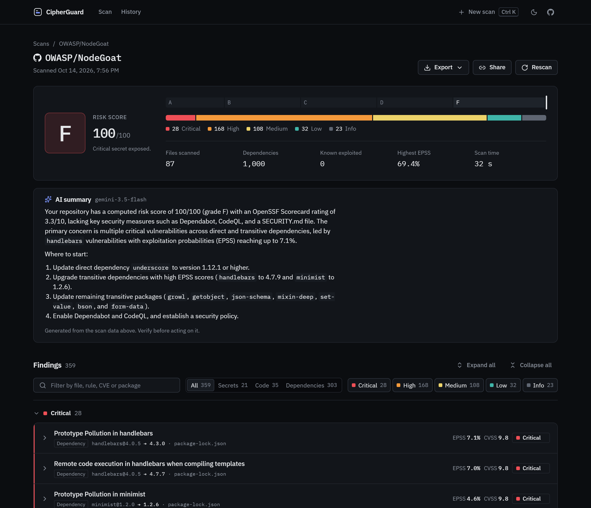
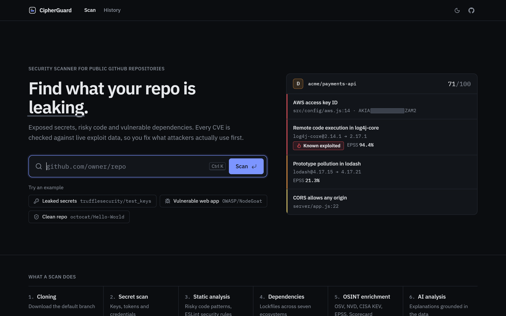
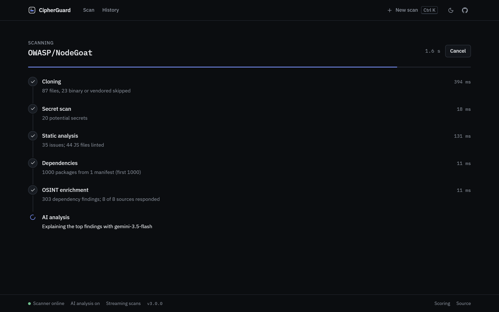
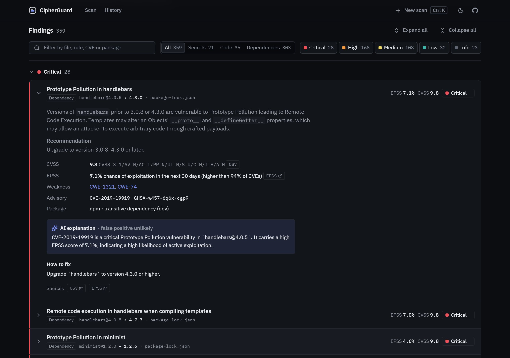
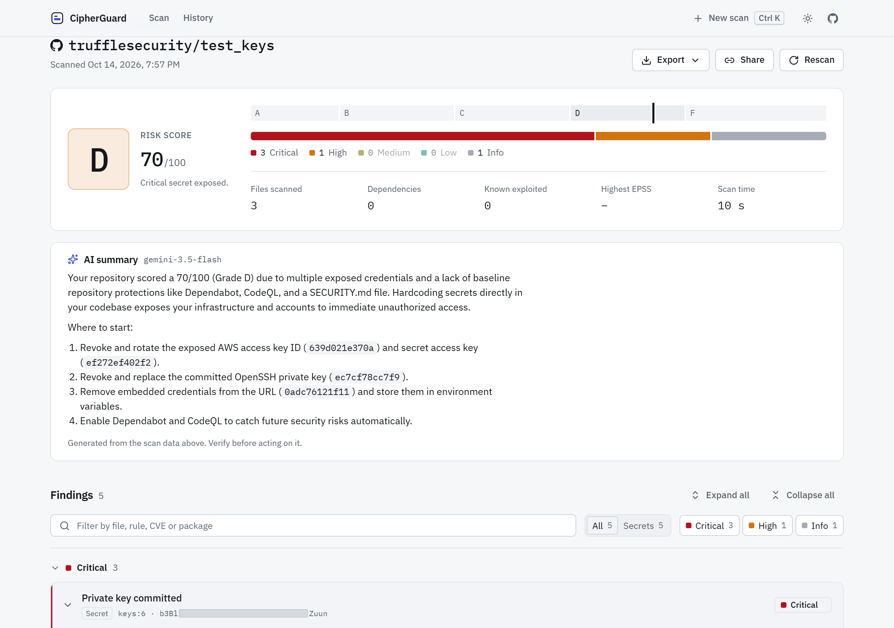
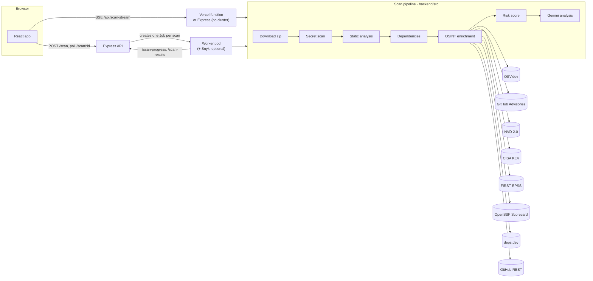

# CipherGuard

Security scanner for public GitHub repositories. CipherGuard finds leaked secrets, risky code and vulnerable dependencies, then checks every CVE against live exploit data (CISA KEV, FIRST EPSS, NVD) so you fix what attackers actually use first.

[](https://github.com/NicholasDarwin/CipherGuard/actions/workflows/ci.yml)
[](https://github.com/NicholasDarwin/CipherGuard/actions/workflows/codeql.yml)




## What a scan does

| Step | What happens |
|---|---|
| 1. Cloning | Downloads the default branch as a zip from GitHub (no git binary needed) |
| 2. Secret scan | 19 rules for private keys, cloud and API keys, tokens, credentials in URLs, passwords |
| 3. Static analysis | Pattern rules (SQL injection, unescaped HTML sinks, dynamic eval, shell execution, …) plus ESLint security rules on JavaScript |
| 4. Dependencies | Reads lockfiles for npm, PyPI, Go, crates.io, RubyGems and Packagist |
| 5. OSINT enrichment | Looks up every dependency and CVE in eight public data sources (below) |
| 6. AI analysis | One Gemini request explains the top findings, grounded in the data above |

The report gives an A–F grade and 0–100 risk score, a severity breakdown, and findings grouped by severity. Each finding shows file and line, a highlighted code snippet, CVSS, EPSS, known-exploited status, the fixed version, remediation, and links to every source. Reports export to Markdown or PDF and can be shared by link.

<table>
  <tr>
    <td></td>
    <td></td>
  </tr>
  <tr>
    <td></td>
    <td></td>
  </tr>
</table>

## Architecture



One pipeline (`backend/src/pipeline.js`) serves both deployments:

- **Vercel** (the default): the React app is static and each scan runs inside a streaming serverless function (`api/scan-stream.js`). Progress arrives as server-sent events.
- **Kubernetes**: the Express API starts one Job per scan, so many repositories scan in parallel. Workers report each step back to the API, and the app polls for it. See [DEPLOYMENT.md](DEPLOYMENT.md).

## OSINT data sources

| Source | Used for | Auth | Limits and handling |
|---|---|---|---|
| [OSV.dev](https://osv.dev) | Known vulnerabilities for each dependency version, fixed versions | None | One `querybatch` call for up to 1,000 packages, then advisory details |
| [GitHub Advisory Database](https://github.com/advisories) | GHSA severity, CVSS, CWE names | Optional `GITHUB_TOKEN` | 60 req/h without a token, so lookups are capped at 25 per scan |
| [NVD API 2.0](https://nvd.nist.gov/developers/vulnerabilities) | CVSS v3.1/v4.0 scores and CWE | Optional `NVD_API_KEY` | 5 req/30 s without a key; known-exploited CVEs are looked up first |
| [CISA KEV](https://www.cisa.gov/known-exploited-vulnerabilities-catalog) | "Known exploited" flag, ransomware use | None | Whole feed cached 12 h, GitHub mirror as fallback |
| [FIRST EPSS](https://www.first.org/epss/) | Probability of exploitation in the next 30 days | None | Batched 100 CVEs per request |
| [OpenSSF Scorecard](https://scorecard.dev) | Repository posture score and failing checks | None | Not every repo is scored; shown as unavailable |
| [deps.dev](https://deps.dev) | Deprecated and unmaintained packages, licenses | None | Direct dependencies only (first 40) |
| [GitHub REST](https://docs.github.com/rest) | Stars, last push, license, open security issues | Optional `GITHUB_TOKEN` | Shares the GitHub limit above |

Every response is cached with a TTL (in memory, and on disk when writable), and each source has a rate limiter and a request timeout. Enrichment runs under a time budget. **A failing source never fails a scan**: the report marks it "source unavailable" and the rest of the data still appears. Every data point in the UI links to the advisory it came from.

## How the risk score works

Implemented in [`backend/src/risk.js`](backend/src/risk.js).

1. **Weight each finding.** `base × kev × epss`, where
   - `base` is the CVSS base score when known (NVD, then GHSA, then computed from the OSV vector), otherwise by severity: critical 10, high 6, medium 3, low 1, info 0
   - `kev` is 2 if the CVE is in CISA KEV, else 1
   - `epss` is `1 + 2 × EPSS probability`
2. **Group repeats.** Findings with the same rule (or the same advisory) form a group. A group counts its worst finding in full and the rest at 10%, capped at twice the worst, so 50 copies of one low-severity pattern do not outweigh one real vulnerability.
3. **Saturate.** `score = 100 × (1 − e^(−Σ groups / 30))`.
4. **Posture.** Add `min(10, max(0, (7 − Scorecard score) × 2))` when an OpenSSF Scorecard exists.
5. **Floors.** Any known-exploited vulnerability or exposed critical secret sets the score to at least 55 (grade D).
6. **Grade.** A < 15, B < 35, C < 55, D < 75, F ≥ 75.

Findings are ordered for triage by known exploitation first, then severity, then the weight above. The same numbers (CVSS, EPSS, KEV, Scorecard and the score itself) go into the Gemini prompt so the AI summary stays consistent with the report.

## Secrets and privacy

- Secret values are shown as redaction bars. A live report can reveal a value on request; exported, shared and saved reports always contain the masked form only.
- Gemini only receives masked values.
- Scan history is kept in your browser (localStorage), redacted.
- Share links store a redacted copy server-side with a random ID and a 30-day expiry (Upstash/Vercel KV). Without KV configured, the redacted report is compressed into the URL fragment, which browsers never send to a server.

## Run locally

Requires Node 20+.

```bash
npm install
cp .env.example .env      # all keys optional; add GEMINI_API_KEY for AI analysis
npm run dev               # API on :4000, app on http://localhost:5173
```

Without a Kubernetes cluster the API runs scans in-process. Other scripts:

```bash
npm test                  # backend unit tests
npm run lint              # frontend lint
npm run build             # production build into frontend/dist
```

## Configuration

All variables are optional. See [`.env.example`](.env.example).

| Variable | Purpose |
|---|---|
| `GEMINI_API_KEY`, `GEMINI_MODEL` | AI analysis (default model `gemini-3.5-flash`) |
| `GITHUB_TOKEN` | Higher GitHub limits for advisories and repo metadata (read-only, no scopes needed) |
| `NVD_API_KEY` | Higher NVD limits |
| `SNYK_TOKEN` | Adds a Snyk scan in the Kubernetes worker |
| `KV_REST_API_URL`, `KV_REST_API_TOKEN` | Server-stored share links (Vercel KV / Upstash) |
| `SCAN_BUDGET_MS`, `ENRICH_BUDGET_MS`, `MAX_REPO_MB` | Time and size limits per scan |
| `PORT`, `WORKER_IMAGE`, `API_CALLBACK_URL`, `JOB_NAMESPACE`, `CORS_ORIGIN` | Express API and Kubernetes |

## API

| Method | Path | Description |
|---|---|---|
| GET | `/api/scan-stream?repo=<url>` | Run a scan; server-sent events `step`, `status`, `result`, `error` (alias: `/scan_stream`) |
| GET | `/api/health` | Status, mode (`stream` or `cluster`), configured sources |
| POST | `/api/share` | Store a redacted report, returns `{ id, expiresAt }` |
| GET | `/api/share/:id` | Fetch a shared report |
| POST | `/scan` | Start a scan (Kubernetes Job, or in-process) |
| GET | `/scans` | List scans |
| GET | `/scan/:id` | One scan with steps and results |
| POST | `/scan-progress` | Worker step update |
| POST | `/scan-results` | Worker final report |
| GET | `/health` | Health check |

## Project structure

```
api/                    Vercel serverless functions (thin wrappers)
backend/
  src/
    pipeline.js         The six-step scan
    scanner/            Repo download, pattern rules, ESLint, lockfile parsers
    enrich/             OSV, GHSA, NVD, KEV, EPSS, Scorecard, deps.dev, GitHub; cache + rate limits
    risk.js             Risk score and grade
    ai.js               Gemini analysis
    sanitize.js         Secret redaction
    http/               Shared HTTP handlers and share storage
  server.js             Express API + Kubernetes Job orchestration
  scanner-worker.js     Kubernetes Job entry point
  test/                 Unit tests (node:test)
frontend/               React 19 + Vite app
k8s/                    Kubernetes manifests
docs/screenshots/       README images
```

## Limitations

- Public GitHub repositories only.
- Pattern rules are heuristics and can produce false positives; the AI explanation flags likely ones, but verify before acting.
- On Vercel Hobby a scan must finish within 60 s, so very large repositories may be cut short. Raise `SCAN_BUDGET_MS` together with the function's `maxDuration` on plans that allow it.

## License

MIT. See [LICENSE](LICENSE). Only scan repositories you are allowed to assess.
